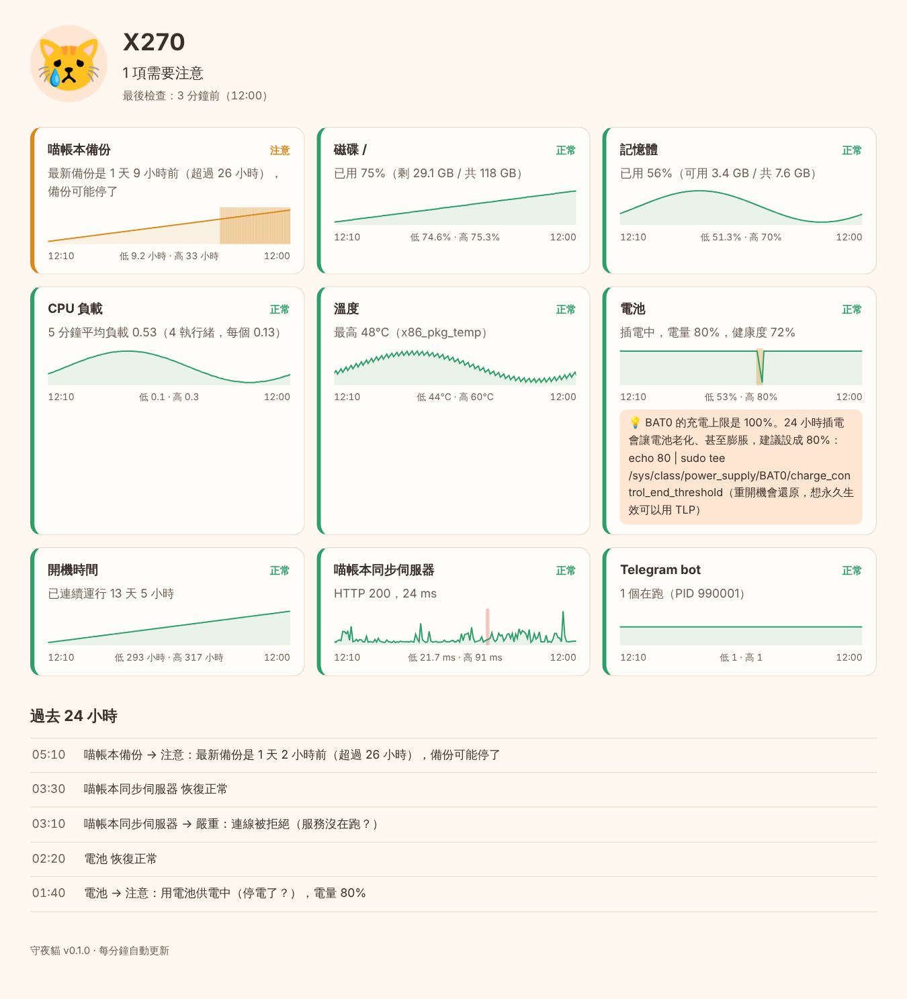

# 🐱 守夜貓 nightcat

**替家裡的小伺服器守夜。磁碟快滿、備份默默停了、停電、服務掛掉，用 Telegram 叫你。**

舊筆電拿來當伺服器很划算，但它出事的時候不會告訴你：備份失敗了三個禮拜才發現、
半夜停電後同步伺服器沒有自己起來、電池 24 小時充到 100% 慢慢膨脹……
守夜貓每 5 分鐘檢查一次，只在**狀態真的改變**時通知你，不會洗版。

- **純 Python 標準庫**（3.10 需要 `tomli`），不用資料庫伺服器、不用 Docker
- **資料只存在本機**一個 SQLite 檔，儀表板完全離線可用
- **有測試**：181 個測試，包含用假的 `/proc`、`/sys` 模擬一整晚停電



## 它會看什麼

| 檢查 | 會發現的事 |
|------|-----------|
| `disk` 磁碟 | 使用率太高；**外接硬碟沒掛上**；日報會預測「照目前速度幾天後會滿」 |
| `memory` 記憶體 | 可用記憶體太少、swap 用太多 |
| `load` CPU 負載 | 5 分鐘平均負載（除以核心數，短暫尖峰不吵你） |
| `temperature` 溫度 | CPU 太燙（風扇積灰塵的老筆電很常見） |
| `battery` 電池 | **停電了**（改用電池供電）、電量快沒了、電池老化；提醒你設定充電上限 |
| `uptime` 開機時間 | **剛重新開機**，並推算之前停機了多久 |
| `backup` 備份 | 太久沒有新備份、檔案是空的、**突然縮水**、**檔案損壞**（實際打開 SQLite / gzip / zip 驗證） |
| `http` 網站 | 同步伺服器、API 沒回應、狀態碼不對、內容不對、太慢 |
| `tcp` 連接埠 | SSH、資料庫、對外網路通不通 |
| `systemd` 服務 | 服務 failed / inactive |
| `process` 行程 | 某支程式（例如 Telegram bot）沒在跑 |
| `command` 任意指令 | 自己寫的檢查腳本，相容 Nagios 外掛結束碼 |

## 通知長什麼樣

半夜 3 點同步伺服器掛了（嚴重，就算在安靜時段也會通知）：

```text
🙀 X270 出狀況了

🔴 喵帳本同步伺服器：連線被拒絕（服務沒在跑？）

10/20 03:20 · 守夜貓
```

10 分鐘後自己好了：

```text
😺 X270 好起來了

🟢 喵帳本同步伺服器：恢復正常，出問題了 20 分鐘（HTTP 200，31 ms）

10/20 03:30 · 守夜貓
```

早上 8 點的日報，整晚發生的事都在裡面：

```text
☀️ X270 日報 · 10/20（二）
😿 有 1 項需要注意

【現在】
🟡 喵帳本備份：最新備份是 1 天 5 小時前（超過 26 小時），備份可能停了
🟢 磁碟 /：已用 75%（剩 29.2 GB / 共 118 GB），照目前速度約 32 天後會滿
🟢 電池：插電中，電量 80%，健康度 72%
🟢 喵帳本同步伺服器：HTTP 200，38 ms
…

【過去 24 小時】
01:40 🟡 電池：用電池供電中（停電了？），電量 80%
02:20 🟢 電池 恢復正常
03:10 🔴 喵帳本同步伺服器：連線被拒絕（服務沒在跑？）
03:30 🟢 喵帳本同步伺服器 恢復正常
05:10 🟡 喵帳本備份：最新備份是 1 天 2 小時前（超過 26 小時），備份可能停了

【建議】
💡 BAT0 的充電上限是 100%。24 小時插電會讓電池老化、甚至膨脹，建議設成 80%：…
```

## 快速開始

### 1. 安裝

建議用 [pipx](https://pipx.pypa.io/)（Ubuntu / Debian：`sudo apt install pipx`），它會把指令裝到 `~/.local/bin`：

```bash
pipx install "git+https://github.com/wooyongbin3-cpu/x270-ai-workspace-.git#subdirectory=projects/nightcat"
```

或是先 clone 下來：

```bash
git clone https://github.com/wooyongbin3-cpu/x270-ai-workspace-.git
pipx install ./x270-ai-workspace-/projects/nightcat
```

Windows / macOS 沒有 `/proc`，要多裝 psutil：`pipx install "./projects/nightcat[psutil]"`。

### 2. 產生設定檔

```bash
nightcat init --name X270
```

它會偵測這台機器有哪些磁碟、溫度感測器、電池、systemd、SSH，產生一份量身訂做的
`~/.config/nightcat/config.toml`。打開它，把最下面「你的服務」那一段改成你的：

```toml
[[check]]
type = "backup"
name = "喵帳本備份"
path = "/srv/meow/backups"   # 改成你的備份資料夾
pattern = "*.db"
max_age = "26h"              # 每天備份一次，超過 26 小時沒有新的就通知
min_size = "4KB"
min_count = 7

[[check]]
type = "http"
name = "喵帳本同步伺服器"
url = "http://127.0.0.1:8080/health"   # 改成你的網址
```

### 3. 試跑

```bash
nightcat check
```

```text
😺 守夜貓 · X270 · 10/20 12:00

  🟢 磁碟 /              已用 75%（剩 29.2 GB / 共 118 GB）
  🟢 記憶體              已用 51%（可用 3.7 GB / 共 7.6 GB）
  🟢 溫度                最高 44°C（x86_pkg_temp）
  🟢 電池                插電中，電量 80%，健康度 72%
     💡 BAT0 的充電上限是 100%。24 小時插電會讓電池老化……
  🟢 喵帳本同步伺服器    HTTP 200，38 ms

全部正常
```

結束碼沿用 Nagios：0 正常、1 注意、2 嚴重、3 未知，方便接到其他工具。

### 4. 接上 Telegram

1. **Bot token**：可以直接用你現有 bot 的 token（守夜貓只負責「傳訊息」，不會跟 bot 本身搶訊息）；
   或是對 [@BotFather](https://t.me/BotFather) 傳 `/newbot` 開一個新的。
2. **Chat id**：對 [@userinfobot](https://t.me/userinfobot) 傳任意訊息，它會回你的 id，填進設定檔的 `chat_id`。
3. 先對你的 bot 按一次 `/start`（bot 不能主動找沒跟它說過話的人）。
4. token 不要寫進設定檔，放在環境變數或 `~/.config/nightcat/env`：

   ```bash
   echo 'NIGHTCAT_TELEGRAM_TOKEN=123456789:AA...' > ~/.config/nightcat/env
   chmod 600 ~/.config/nightcat/env
   set -a; . ~/.config/nightcat/env; set +a
   nightcat test-alert
   ```

### 5. 每 5 分鐘自動執行

**Linux（systemd，推薦）**：用使用者層級的 timer，不需要 root：

```bash
sh projects/nightcat/deploy/install-systemd.sh              # 定時檢查
sh projects/nightcat/deploy/install-systemd.sh --dashboard  # 連儀表板一起
```

腳本會複製 [`deploy/`](deploy/) 裡的 unit 檔到 `~/.config/systemd/user/`、啟用 timer，
並執行 `loginctl enable-linger`，讓你沒登入時也照樣跑。看紀錄：
`journalctl --user -u nightcat.service -n 20`。

**cron**：

```cron
*/5 * * * * . $HOME/.config/nightcat/env; $HOME/.local/bin/nightcat run --quiet
```

**Windows**（工作排程器）：

```powershell
setx NIGHTCAT_TELEGRAM_TOKEN "123456789:AA..."
schtasks /Create /SC MINUTE /MO 5 /TN nightcat /TR "%USERPROFILE%\.local\bin\nightcat.exe run --quiet"
```

## 儀表板

```bash
nightcat serve          # http://127.0.0.1:8077
```

每張卡片有 24 小時趨勢線，出問題的時段會用色條標出來；下面是過去 24 小時的事件。
如果 `nightcat run` 超過 20 分鐘沒跑，頁面最上面會提醒你 timer 可能停了。

預設只聽 `127.0.0.1`。想用手機在家裡看，可以 `nightcat serve --host 0.0.0.0`
（區網裡的人都看得到），或是用 SSH 通道：`ssh -L 8077:127.0.0.1:8077 x270`。

## 什麼時候會通知你

守夜貓記得「**你最後一次知道的狀態**」。只有實際狀態跟你知道的不一樣時才發通知：

- **連續確認**：網路類的檢查（`http`、`tcp`）預設要連續失敗 2 次才算數，抖一下不吵你。
  每項檢查都可以用 `confirm = 3` 調整。變好則是立刻算數。
- **安靜時段**（`quiet_hours = "23:30-07:00"`）：這段時間只發「嚴重」的。
  「注意」等級的問題如果早上還沒好，安靜時段一結束就會通知；半夜自己好了的，只會出現在日報裡。
- **持續提醒**：嚴重的問題一直沒好，每 6 小時（`remind_every`）再提醒一次。
- **斷網補送**：停電時路由器通常也掛了，送不出去的通知會先存起來，網路恢復後補送，並標上原本的時間。
- **出問題多久**從第一次失敗算起，不是從確認的那一刻。
- **一次性事件**（重新開機）只通知一次，不會再發「已恢復」。

## 設定檔參考

```toml
[nightcat]
host_name = "X270"
quiet_hours = "23:30-07:00"   # 留空 = 不分時段
daily_report = "08:00"        # 留空 = 不送日報
remind_every = "6h"           # 0 = 不重複提醒
keep_days = 30                # 歷史紀錄保留天數
# data_dir = "~/.local/share/nightcat"

[telegram]
chat_id = "123456789"
# token = "..."               # 建議改用環境變數 NIGHTCAT_TELEGRAM_TOKEN
# token_env = "MY_BOT_TOKEN"  # 或指定別的環境變數名稱

[dashboard]
host = "127.0.0.1"
port = 8077
stale_after = "20m"
```

每個 `[[check]]` 都可以加 `name`（顯示名稱）、`confirm`（連續幾次才算數）、`enabled = false`（暫時關掉）。
時間可以寫 `90s`、`30m`、`26h`、`1h30m`、`2d`；大小可以寫 `4KB`、`10MB`、`2GB`。
選項打錯字會直接報錯（例如 `wran = 80`），不會默默被忽略。

| type | 選項（= 預設值） |
|------|------------------|
| `disk` | `path = "/"`、`warn = 85`、`crit = 95`（%）、`min_free`、`must_be_mount = false` |
| `memory` | `warn = 90`、`crit = 97`（%）、`swap_warn` |
| `load` | `warn = 1.5`、`crit = 3.0`（每個執行緒的 5 分鐘平均負載） |
| `temperature` | `warn = 80`、`crit = 92`（°C）、`sensor`（只看名稱含這段文字的感測器） |
| `battery` | `on_battery = "warn"`、`low = 25`（%，供電中低於這個算嚴重）、`min_health = 50`、`recommend_limit = 80` |
| `uptime` | `recent = "20m"`（開機不到這麼久算「剛重新開機」） |
| `backup` | `path`（必填）、`pattern = "*"`（可用 `**/*.db`）、`max_age = "26h"`、`min_size = 1`、`shrink = 0.5`、`min_count = 0`、`verify = true`、`verify_max_size = "2GB"` |
| `http` | `url`（必填）、`expect_status`（例如 `[200, 401]`，預設 2xx/3xx）、`contains`、`timeout = 10`、`warn_ms`、`method = "GET"`；`confirm` 預設 2 |
| `tcp` | `host = "127.0.0.1"`、`port`（必填）、`timeout = 5`；`confirm` 預設 2 |
| `systemd` | `unit`（必填）、`user = false` |
| `process` | `match`（必填，正規表示式，比對完整指令列）、`min = 1` |
| `command` | `cmd`（必填，字串或陣列）、`timeout = 30`。結束碼 0 正常、1 注意、2 嚴重、3 未知；輸出第一行當摘要 |

## 讓你的 Telegram bot 也能查

```bash
nightcat check --json
```

會輸出所有檢查結果的 JSON。在你自己的 bot 裡加一個 `/status` 指令：

```python
import json, subprocess


def status_text() -> str:
    out = subprocess.run(["nightcat", "check", "--json"], capture_output=True, text=True)
    data = json.loads(out.stdout)
    icons = {"ok": "🟢", "warn": "🟡", "crit": "🔴", "unknown": "⚪"}
    return "\n".join(f"{icons[r['status']]} {r['name']}：{r['summary']}" for r in data["results"])
```

## 開發

```bash
cd projects/nightcat
pip install -e ".[dev]"
pytest                 # 181 個測試
ruff check . && ruff format --check . && mypy src
```

```text
src/nightcat/
├── cli.py        指令列（init / check / run / report / serve / test-alert）
├── app.py        一次完整的執行：檢查 → 記錄 → 判斷 → 通知 → 日報
├── host.py       讀 /proc、/sys（可以指向假的目錄樹測試）；沒有 procfs 時改用 psutil
├── checks/       各種檢查，每個都是一個小 class，宣告自己的選項
├── runner.py     每項檢查跑在自己的 daemon thread，卡死的那項不會拖住其他項
├── alerts.py     什麼時候該通知（確認、安靜時段、提醒）——純函式，最好測
├── store.py      SQLite：結果、狀態、事件、待送通知
├── notify.py     Telegram 與斷網補送
├── report.py     日報與磁碟預測（最小平方法）
├── dashboard.py  本機儀表板（標準庫 http.server + 一頁自帶的 HTML）
└── probe.py      init 時偵測這台機器、產生設定檔
```

測試不碰真的系統：`tests/conftest.py` 的 `FakeTree` 會造一棵假的 `/proc` + `/sys`，
`tests/test_app.py` 用它模擬一整晚「停電 → 電量變低 → 電來了重新開機 → 早上日報」。

## 授權

MIT
